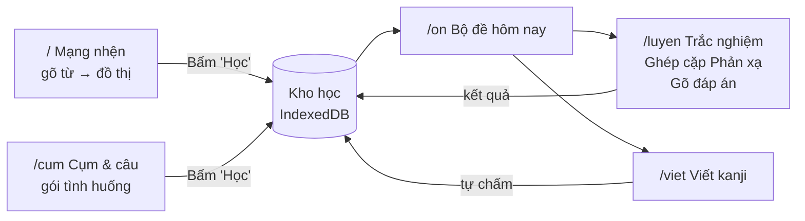

# PLAN – Web học tiếng Nhật theo Kanji + Mạng nhện

> File này viết cho coding agent (Antigravity CLI `agy`). Agent đọc từ trên xuống và làm theo thứ tự các Phase, bắt đầu từ **P-1**.
> **Thay toàn bộ** app cũ `tan-suat-app` (tra tần suất). Xóa giao diện và bản cũ. App mới nằm ở **gốc repo** và đẩy lên https://github.com/Tlerd/studyjapan (nhánh `main`). Xem mục 15.
> Chỉ giữ lại **dữ liệu và logic** của bản cũ: `freq.json` 25.000 từ, script build, hàm tra cứu (mục 15.2).
> Phương pháp: `docs/Cach-Nao-Ghi-Nho-Hoc-Tieng-Nhat.md` (thang 4 bậc, ôn giãn cách).

---

## 0. Mục tiêu và 7 nguyên tắc

| # | Nguyên tắc | Cách web thể hiện |
|---|---|---|
| 1 | **Nút học là kanji, không phải từ** | Học 学 → mở khóa 学生, 大学, 学校, 留学. Kanji là nút trung tâm của mạng nhện. |
| 2 | **Đơn vị luyện là cụm và câu** | 電車に乗る dạy cùng lúc 電車, 乗る và trợ từ に. |
| 3 | **Gõ một từ là có mạng nhện ngay** | Không cần bấm nút. Đồ thị hiện sau khi gõ dưới 100 ms. |
| 4 | **Chia theo gốc kanji và tình huống** | Không có màn hình "danh sách từ rời". |
| 5 | **Nối theo chủ đề/câu chuyện, giãn từ cùng loại** | Theo ảnh 2: học 駅, 切符, 乗る, 遅れる cùng lúc. Không học 月曜日, 火曜日, 水曜日 cùng ngày. |
| 6 | **Leo thang 4 bậc** | Nhận ra (Trắc nghiệm, Ghép cặp Phản xạ) → Nhớ ra (gõ) → Viết ra (viết kanji) → Dùng (câu). |
| 7 | **Học rồi là tự vào bộ đề ôn** | Từ, cụm và kanji đã học tự gom thành bộ đề, có lịch nhắc. |
| 8 | **Kanji = lắp mảnh LEGO (bộ)** | 泊 = 氵 Nước (trái) + 白 Trắng (phải) + hình ảnh 3 giây. Khi viết, não chỉ cần "lắp mảnh". Xem mục 3A. |
| 9 | **Chia cấp N5 → N1, cấp dưới dùng cho cấp trên** | Chọn N3 → học mục mới của N3, còn từ N4, N5 vẫn dùng trong mạng nhện, câu ví dụ, đáp án và bộ đề. Xem mục 3B. |

Furigana (chữ nhỏ phía trên) dùng thẻ `<ruby>`. Cách đọc lấy từ API parse mà **JitenReader** (https://github.com/Sirush/JitenReader) dùng. Không tô màu chữ để thể hiện cách đọc.

---

## 1. Quyết định cần chốt trước khi code

> [!IMPORTANT]
> Agent dừng ở đây và hỏi người dùng nếu chưa có câu trả lời. Giá trị mặc định ghi trong ngoặc.

1. **Vị trí code.** ✅ **Đã chốt:** thay toàn bộ. Xóa `tan-suat-app` và giao diện cũ. App mới là một app Next.js ở **gốc repo** `studyjapan`. Không giữ trang tra tần suất. Quy trình ở mục 15.
2. **Nghĩa tiếng Việt lấy từ đâu.** Không có từ điển Nhật–Việt mở có giấy phép rõ ràng. (Mặc định:
   - Kanji: âm Hán Việt từ KANJIDIC2 + nghĩa tiếng Anh.
   - Từ: nghĩa tiếng Anh từ JMdict. Khi người dùng bấm "Học", app gọi Gemini dịch sang tiếng Việt, lưu cache, và cho sửa tay.)
3. **Trắc nghiệm & Ghép cặp Phản xạ đã có code ở app khác chưa?** (Mặc định: làm mới theo mục 7. Nếu có code cũ thì agent port sang.)
4. **Đồng bộ nhiều máy.** (Mặc định: lưu trên máy bằng IndexedDB + nút xuất/nhập JSON. Không đăng nhập.)
5. **Danh sách JLPT.** ✅ **Đã chốt:** dùng danh sách của Jonathan Waller (tanos.co.uk, CC BY). JLPT không công bố danh sách chính thức từ năm 2010. Trên giao diện, mọi nhãn cấp ghi **"cấp ước tính"**.
6. **Tên tiếng Việt của mảnh LEGO.** ✅ **Đã chốt:** chưa có nguồn mở. Agent **tự soạn** `data/components-vi.json` (~250 mảnh) trong Phase 1b, theo quy trình ở mục 3A.5.

---

## 2. Các màn hình



| Route | Nội dung |
|---|---|
| `/` | Ô gõ + mạng nhện + bảng chi tiết nút đang chọn |
| `/cum` | Gói tình huống và câu chuyện ngắn (ảnh 2) |
| `/on` | Bộ đề hôm nay: số thẻ đến hạn, bắt đầu ôn |
| `/luyen` | Trắc nghiệm · Ghép cặp Phản xạ · Gõ đáp án |
| `/viet` | Viết kanji: xem nét → tô → viết từ trí nhớ |
| `/cap/[n5…n1]` | Trang riêng của từng cấp: kanji, từ, cụm, tình huống của cấp đó + tiến độ |
| `/bo` và `/bo/[manh]` | Bảng các mảnh LEGO (bộ). Trang một mảnh: nghĩa, cách nhớ, mọi kanji chứa mảnh đó |

Header có ở mọi trang:
- Badge "🔔 12 thẻ đến hạn".
- Bộ chọn cấp: **N5 · N4 · N3 · N2 · N1** (mục 3B).

---

## 3. Mạng nhện (trọng tâm)

### 3.1 Hành vi khi gõ
- Gõ `日` (một kanji) → nút giữa là kanji 日.
- Gõ `日本` (một từ) → nút giữa là từ 日本. Vòng 1 là các kanji 日 và 本. Mỗi kanji mở ra các từ khác chứa nó.
- Gõ kana (`にほん`) → tra cách đọc như `lookup.ts` → đổi sang 日本.
- Gõ romaji → đổi sang kana bằng `wanakana` khi gõ.
- Debounce 150 ms. Không cần nhấn Enter.

### 3.2 Bố cục (theo ảnh 1)

```
                 毎日 (まいにち) – mỗi ngày
                        │
日本 (にほん) ── 日 (ひ/にち・NHẬT) ── 日曜日 (にちようび) – Chủ nhật
     │                  │
本屋 (ほんや)        今日 (きょう) – hôm nay   ⚠ đọc đặc biệt
 – hiệu sách
```

- **Nút kanji** (to, tròn): chữ + âm on/kun + âm Hán Việt in hoa.
- **Nút từ** (thẻ bo góc): từ có furigana `<ruby>` + nghĩa tiếng Việt nhỏ + chấm hạng tần suất.
- **Vòng 1:** tối đa 6 từ chứa kanji giữa, xếp theo hạng tần suất tốt nhất. Có nút "+ xem thêm".
- **Vòng 2 (cầu nối):** từ ở vòng 1 có kanji khác (日本 có 本) → hiện nút kanji 本 mờ, rồi 本屋. Thu gọn mặc định, bấm để mở.
- **Bấm một nút** → nút đó thành nút giữa. Có thanh "breadcrumb" để quay lại (日 › 本 › 本屋).
- **Từ đọc đặc biệt** (今日 = きょう, 大人 = おとな): furigana phủ cả từ, có nhãn ⚠ "đọc đặc biệt".

### 3.3 Ba loại cạnh (điều chỉnh theo ảnh 2)

| Cạnh | Nét | Ý nghĩa | Mặc định |
|---|---|---|---|
| Cùng kanji | liền, xám | 日 ── 毎日 | Hiện |
| Cùng tình huống | đứt, xanh lá, có mũi tên thứ tự | 駅 → 切符 → 乗る → 遅れる | Hiện nếu từ thuộc một gói tình huống |
| Cùng loại – **không học cùng ngày** | chấm, đỏ nhạt | 月曜日 ⋯ 火曜日 | Ẩn. Bật bằng công tắc "Cảnh báo nhiễu" |
| Cùng mảnh LEGO | liền, mảnh, màu cam | 泊 ── 氵 ── 泳, 海 | Ẩn. Bật bằng công tắc "Xem theo bộ" |

Có công tắc **"Xem theo: Kanji | Tình huống"**:
- **Kanji:** bố cục mục 3.2.
- **Tình huống:** nút giữa là tình huống (vd: 🚉 駅で). Các từ xếp thành chuỗi câu chuyện theo thứ tự: 朝 起きる → 顔を洗う → 学校へ行く.

### 3.4 Bảng chi tiết (bên phải hoặc dưới đồ thị trên điện thoại)
- Kanji: âm on, kun, Hán Việt, nghĩa, số nét, nhãn cấp (N5…N1), nút **"✍️ Viết"** (mở `/viet`).
- Kanji: khối **"🧱 Mảnh LEGO"** như mục 3A (mảnh + vị trí + hình ảnh 3 giây + câu lệnh khi viết).
- Từ: furigana, nghĩa, hạng tần suất, 1–2 câu ví dụ có furigana, các tình huống chứa từ.
- Nút **"＋ Học"** cho từ, cụm và kanji. Nút đổi thành "✓ Đang học" sau khi bấm.
- Kanji đã học thì sáng trên đồ thị. Từ có **mọi** kanji đã học có nhãn 🔓 "đã mở khóa".

### 3.5 Kỹ thuật
- Thư viện: **`@xyflow/react`** (nút là HTML → dùng được `<ruby>`) + **`d3-force`** để tự xếp vị trí.
- Chỉ mục dựng một lần khi tải: `Map<kanji, wordIndex[]>` từ 25.000 từ, đã sắp theo hạng.
- Kéo thả, phóng to bằng hai ngón, chạm để chọn. Không tràn ngang ở 375 px.
- Lọc theo cấp đang chọn (mục 3B): từ cao hơn cấp đang chọn bị ẩn hoặc làm mờ.

---

## 3A. Mảnh LEGO (bộ) – chia kanji thành các bộ để dễ hiểu

### 3A.1 Khối "Mảnh LEGO" của một kanji (theo ảnh 3)

```
泊  (とまる / ハク · BẠC) – trọ qua đêm                       N3
┌──────────────────────────────────────────────────────────┐
│ 🧱 Gồm 2 mảnh LEGO:  [氵 Nước]  +  [白 Màu trắng]          │
│    vị trí:            trái          phải                  │
│ 🖼️ Hình ảnh 3 giây: Đi trọ qua đêm ở khách sạn, vừa bật   │
│    vòi nước (氵) ra thì thấy nước đục ngầu trắng xóa (白). │
│ ✍️ Khi viết: "Lắp mảnh Nước bên trái, mảnh Trắng bên phải".│
│    Xong chữ!                                              │
└──────────────────────────────────────────────────────────┘
```

- Mỗi mảnh là một chip bấm được → mở `/bo/[manh]`.
- Mảnh có màu riêng. Cùng màu đó tô nét của mảnh trong hình chữ KanjiVG. (Đây là màu cho **nét vẽ**, không tô màu chữ để thể hiện cách đọc.)
- **Câu lệnh khi viết** tự sinh từ vị trí: trái/phải, trên/dưới, ngoài/trong, bao quanh.
- **Hình ảnh 3 giây**:
  - Có gợi ý sẵn (AI soạn theo mẫu "mảnh A + mảnh B → nghĩa", người dùng duyệt).
  - Người học sửa thành chuyện **về chính mình** (hiệu ứng tự tham chiếu). Bản của người học được ưu tiên hiển thị.
  - Giữ chuyện ngắn và có nghĩa (Rose, 2013: chuyện quá rắc rối làm mất nghĩa).

### 3A.2 Trang một mảnh `/bo/[manh]`
- Tên mảnh: hình dạng + tên tiếng Việt dễ hiểu + tên bộ Hán Việt. Ví dụ: 氵 = "Nước" (bộ Thủy, dạng 3 chấm).
- Mọi kanji chứa mảnh đó, chia theo cấp N5 → N1: 泳, 海, 洗, 泊, 温…
- Nút "Học mảnh này".

### 3A.3 Thứ tự học
- Học mảnh trước, ráp chữ sau. Khi người học bấm "Học" một kanji mà có mảnh chưa học → app gợi ý: "泊 cần mảnh 氵 và 白. Học 2 mảnh này trước?"
- Mảnh có thẻ ôn riêng (chỉ bậc Nhận ra và Nhớ ra). Mảnh nhẹ, không tính vào giới hạn mục mới mỗi ngày.

### 3A.4 Dữ liệu mảnh
| Dữ liệu | Nguồn |
|---|---|
| Kanji gồm những mảnh nào | KRADFILE / kradfile-u (EDRDG, CC BY-SA 4.0) |
| Vị trí mảnh (trái, phải, trên, dưới…) | Nhóm nét trong KanjiVG (thuộc tính `kvg:element`, `kvg:position`) |
| Tên tiếng Việt của mảnh | Tự soạn `data/components-vi.json` cho ~250 mảnh: 214 bộ thủ Khang Hy + các mảnh hay gặp |
| Hình ảnh 3 giây | Gợi ý AI + người học sửa, lưu trong IndexedDB |

> [!NOTE]
> KRADFILE đôi khi tách kanji quá nhỏ hoặc dùng mảnh thay thế. Ưu tiên tách theo KanjiVG (cấp nhóm nét đầu tiên). Chỉ dùng KRADFILE khi KanjiVG không có nhóm.

### 3A.5 Tự soạn tên tiếng Việt cho mảnh (Phase 1b)

Chưa có nguồn mở cho tên tiếng Việt của mảnh. Agent tự soạn theo các bước sau:

1. Lấy danh sách mảnh thật từ `public/components.json`. Đếm số kanji N5–N1 chứa mỗi mảnh.
2. Sắp mảnh theo số kanji chứa nó, nhiều nhất lên đầu.
3. Soạn tên cho **mọi mảnh xuất hiện trong kanji N5–N1** (~250 mảnh). Bắt đầu từ 214 bộ thủ Khang Hy.
4. Mỗi mảnh có các trường:

```json
{
  "part": "氵",
  "vi": "Nước",                 // tên dễ hiểu, 1–2 từ, dùng trong câu lệnh lắp mảnh
  "hanViet": "bộ Thủy",          // tên bộ Hán Việt; để null nếu mảnh không phải bộ thủ
  "variantOf": "水",             // dạng gốc nếu đây là dạng biến thể; null nếu không có
  "hint": "3 giọt nước bên trái", // gợi ý hình dạng, tối đa 10 từ
  "kanjiCount": 120,             // số kanji N5–N1 chứa mảnh này
  "reviewed": false              // true sau khi người dùng duyệt
}
```

5. Quy tắc đặt tên:
   - Một mảnh có **một tên duy nhất**. Dạng biến thể dùng cùng tên với dạng gốc (氵, 水 → "Nước").
   - Dùng từ ngắn, cụ thể, dễ vẽ ra trong đầu: "Nước", "Trắng", "Cây", "Người đứng".
   - Hai mảnh khác nhau không dùng chung một tên.
6. Agent xuất file `data/components-vi.review.md`: một bảng gồm mảnh, tên, Hán Việt, 3 kanji ví dụ. Người dùng duyệt và sửa trong bảng này.
7. Sau khi duyệt, đổi `reviewed` thành `true`. Mảnh chưa duyệt vẫn hiện, có nhãn nhỏ "chưa duyệt".

---

## 3B. Cấp độ N5 → N1 (học riêng từng cấp, cấp dưới dùng cho cấp trên)

### 3B.1 Hai chế độ của bộ chọn cấp
Người học chọn một cấp, ví dụ **N3**:

| Phần | Phạm vi |
|---|---|
| **Mục mới để học** (kanji, từ, cụm, tình huống, mảnh) | **Chỉ N3** |
| Mạng nhện, câu ví dụ, đáp án nhiễu, gói tình huống | **N3 + N4 + N5** (tích lũy) |
| Bộ đề ôn | Mọi thẻ đã học, **mọi cấp** (thẻ N5 cũ vẫn đến hạn bình thường) |

Ví dụ: chọn N3, học 泊 (N3). Mạng nhện vẫn hiện 日, 本, 学 (N5) làm cầu nối. Câu ví dụ dùng từ N3 + N4 + N5.

Công tắc phụ trong mạng nhện: **"Hiện từ cấp cao hơn (mờ)"**. Mặc định tắt.

### 3B.2 Trang cấp `/cap/n3`
- Các nhóm: Mảnh LEGO mới · Kanji · Từ · Cụm & câu · Gói tình huống.
- Kanji xếp theo nhóm **cùng mảnh** hoặc **cùng tình huống**, không xếp theo bảng chữ cái.
- Thanh tiến độ: "Kanji N3: 85/370 · Từ N3: 410/1.800".
- Thanh tiến độ tích lũy: "Đã sẵn sàng cho N3: 72% (tính cả N4, N5)".
- Người học có thể vào trang N3 dù N5 chưa xong. App chỉ hiện nhắc: "Còn 40 kanji N5 chưa học".

### 3B.3 Gán cấp cho mỗi mục
- Kanji: cấp theo danh sách JLPT của Jonathan Waller (quyết định 1.5). Nhãn hiển thị: "N3 · cấp ước tính".
- Từ: cấp theo danh sách từ vựng JLPT. Từ không có trong danh sách → **cấp suy ra** = cấp cao nhất của các kanji trong từ. Hiện nhãn "suy ra".
- Từ chỉ có kana, không có trong danh sách → cấp suy theo hạng tần suất (mốc ước tính của app cũ: 800 / 1.500 / 3.750 / 6.000 / 11.000).
- Cụm và câu: cấp = cấp cao nhất của các từ bên trong.
- Mảnh LEGO: cấp = cấp thấp nhất của kanji chứa mảnh đó.
- Mục không thuộc N5–N1 → nhóm "Ngoài JLPT".

### 3B.4 Quy tắc lọc trong code
```ts
type Level = 5 | 4 | 3 | 2 | 1;          // 5 = N5 (dễ nhất)
const inScope = (itemLevel: Level, chosen: Level) => itemLevel >= chosen; // N3 dùng N3, N4, N5
const isNewForLevel = (itemLevel: Level, chosen: Level) => itemLevel === chosen;
```

---

## 4. Dữ liệu

| Dữ liệu | Nguồn | Giấy phép | Output |
|---|---|---|---|
| Từ + hạng | `public/freq.json` (đã có, jiten.moe) | CC BY-SA 4.0 | giữ nguyên |
| Kanji: on, kun, **Hán Việt**, nghĩa EN, số nét, lớp | KANJIDIC2 (EDRDG). Âm Hán Việt nằm ở `reading r_type="vietnam"` | CC BY-SA 4.0 | `public/kanji.json` |
| Nghĩa EN + loại từ | JMdict (bản JSON `jmdict-simplified`), chỉ lấy từ có trong top 25.000 | CC BY-SA 4.0 | `public/words.json` |
| Thứ tự nét | KanjiVG | CC BY-SA 3.0 | `public/kanjivg/{mã}.svg`, tải khi cần |
| Câu ví dụ | Tatoeba (câu Nhật) + gói tự soạn | CC BY 2.0 FR | `public/sentences.json` |
| Gói tình huống | Tự soạn + AI soạn, người dùng duyệt | – | `data/packs/*.json` |
| Nhóm "cùng loại" | Tự soạn: thứ, tháng, số, màu, bộ phận cơ thể, gia đình… | – | `data/categories.json` |
| Mảnh LEGO của kanji | KRADFILE / kradfile-u (EDRDG) + nhóm nét KanjiVG | CC BY-SA 4.0 / 3.0 | `public/components.json` |
| Tên tiếng Việt của mảnh | Tự soạn (~250 mảnh), người dùng duyệt (mục 3A.5) | – | `data/components-vi.json` |
| Cấp JLPT kanji + từ | Danh sách Jonathan Waller (tanos.co.uk). Kiểm tra chéo bằng repo `davidluzgouveia/kanji-data` | CC BY / MIT | trường `jlpt` trong `kanji.json`, `words.json` |

> [!IMPORTANT]
> Quy tắc bắt buộc: agent **mở file nguồn, in 5 mục đầu, ghi cấu trúc thật vào `data/README.md`** trước khi viết script. Không đoán trường dữ liệu.

**Schema gói tình huống:**
```json
{
  "id": "eki",
  "title": "🚉 Ở nhà ga",
  "kind": "situation",            // hoặc "story" (câu chuyện có thứ tự)
  "items": [
    { "text": "駅", "vi": "nhà ga" },
    { "text": "切符を買う", "vi": "mua vé" },
    { "text": "電車に乗る", "vi": "lên tàu" },
    { "text": "電車が遅れる", "vi": "tàu bị trễ" }
  ]
}
```

**Script `scripts/build-kanji.ts`** in ra kiểm tra:
- 学 có 学生, 大学, 学校, 留学.
- 日 có 毎日, 日本, 日曜日, 今日.
- 学 có âm Hán Việt "HỌC".
- 泊 có 2 mảnh 氵 (trái) + 白 (phải).
- Số kanji theo cấp xấp xỉ: N5 ~80 · N4 ~170 · N3 ~370 · N2 ~370 · N1 ~1.200.
- 学 là N5, 泊 là N3. 学生 có cấp N5.
- `kanji.json` + `words.json` ≤ 3 MB thô.

---

## 5. Furigana bằng JitenReader

1. Agent **đọc source JitenReader trước**. Ghi lại endpoint parse, header, và cấu trúc response vào `data/README.md`. Không đoán.
2. Gọi qua API route `app/api/parse/route.ts`. Key để trong biến môi trường `JITEN_API_KEY` trên Vercel. **Không** đưa key lên client hoặc vào git.
3. Cache kết quả parse: bộ nhớ server + IndexedDB phía client. Debounce. Tôn trọng giới hạn 300 request/phút.
4. Component `<Furigana surface reading />` tách okurigana: 食べる → `<ruby>食<rt>た</rt></ruby>べる`. Từ đọc đặc biệt (今日) → ruby phủ cả từ.
5. Thứ tự lấy cách đọc:
   - Từ đơn: `freq.json` / JMdict (không cần gọi API).
   - Cụm và câu: API parse của jiten.
   - Không có key hoặc lỗi mạng: hiện chữ không furigana + ghi chú nhỏ.
6. Nút **"Ẩn furigana"** dùng khi luyện nhớ ra.
7. Chỉ dùng cá nhân. Không mở API route công khai làm relay (luật jiten).

---

## 6. Học theo cụm và câu

- 4 loại mục học: **Kanji · Từ · Cụm · Câu**.
- Một cụm lưu các token: `{ surface, reading, base, pos, isParticle }` (lấy từ API parse).
- Học 電車に乗る → tự liên kết với nút 電車, 乗る, 車, 乗 trên mạng nhện và trợ từ に.
- Trợ từ được **gạch chân** (không tô màu chữ), chạm vào thì hiện giải thích ngắn: "に: chỉ nơi lên xe".
- Bài tập riêng cho cụm:
  - Điền trợ từ: 電車＿乗る → chọn/gõ に.
  - Xếp thẻ chữ thành câu đúng thứ tự.
- Trang `/cum` hiện các gói tình huống. Nút "Học cả gói" thêm mọi mục vào kho học, có luật chống nhiễu ở mục 9.3.

---

## 7. Luyện tập: Trắc nghiệm & Ghép cặp Phản xạ (giữ cách cũ, nâng bậc)

| Chế độ | Bậc | Mô tả |
|---|---|---|
| **Trắc nghiệm** | 1 | 4 lựa chọn. Hai chiều: Nhật → Việt và Việt → Nhật. Kanji → âm Hán Việt/cách đọc. Đáp án nhiễu lấy từ cùng kanji, cùng mảnh hoặc cùng tình huống (khó vừa đủ), chỉ trong phạm vi cấp đang chọn trở xuống. |
| **Ghép cặp Phản xạ** | 1 | Lưới 2 cột, 5–6 cặp. Ghép đúng thì cặp mới rơi vào ngay. Sai thì rung + ghi lỗi. Có đồng hồ. |
| **Gõ đáp án** | 2 | Nhìn nghĩa → gõ romaji, `wanakana` đổi sang kana. Nhìn kanji → gõ cách đọc. |
| **Điền trợ từ / xếp câu** | 2–4 | Dành cho cụm và câu (mục 6). |

Mỗi câu trả lời gửi điểm cho bộ lập lịch:
- Sai → `Again`.
- Đúng nhưng chậm (> 6 giây) → `Hard`.
- Đúng → `Good`.
- Đúng nhanh (< 2 giây) liên tiếp → `Easy`.

> [!NOTE]
> Theo tài liệu phương pháp, thời gian ghép cặp chỉ là phụ. Chỉ số chính trên trang thống kê là **"số kanji viết đúng khi che đáp án"**.

---

## 8. Viết kanji

1. **Xem mẫu:** KanjiVG chạy hoạt ảnh từng nét, có số thứ tự nét. Mỗi mảnh LEGO có màu nét riêng.
2. **Lắp mảnh:** kéo các chip mảnh (氵, 白) vào đúng ô trái/phải trên khung chữ. Đây là bước "não ra lệnh lắp mảnh".
3. **Tô theo:** mẫu mờ nằm dưới canvas. Người học tô lên.
4. **Viết từ trí nhớ:** che mẫu. Chỉ hiện nghĩa + Hán Việt + một từ ví dụ có ô trống (vd: ＿生 = がくせい). Nút "Gợi ý" hiện câu lệnh lắp mảnh, chưa hiện nét.
5. **So sánh:** đặt nét của người học chồng lên mẫu. Người học tự chấm: Again / Hard / Good / Easy.
6. Nút **"🔊 Đọc to"** dùng Web Speech API `ja-JP` (cửa miệng).

Canvas dùng Pointer Events (chuột, ngón tay, bút). Có nút Hoàn tác nét và Xóa.
Sau này (không bắt buộc): tự kiểm tra số nét và hướng nét bằng cách so với path của KanjiVG.

---

## 9. Kho học, bộ đề và nhắc ôn

### 9.1 Tự gom bộ đề
- Bấm "＋ Học" ở bất kỳ đâu → tạo **mục học** + các **thẻ theo kỹ năng**:

| Mục | Thẻ tự tạo |
|---|---|
| Kanji | Nhận ra (trắc nghiệm) · Nhớ ra (Hán Việt/cách đọc) · **Viết ra** |
| Từ | Nhận ra · Nhớ ra (gõ) · Viết ra (nếu có kanji) |
| Cụm / câu | Nhận ra · Điền trợ từ · Xếp câu |
| Mảnh LEGO | Nhận ra (hình → tên) · Nhớ ra (tên → hình) |

- Bộ đề "Hôm nay" = mọi thẻ đến hạn. Thẻ được **nhóm theo kanji hoặc tình huống**, không xếp rời.
- Bộ đề gồm thẻ của **mọi cấp đã học**. Chọn N3 không làm mất thẻ N5, N4 đến hạn.
- Lọc bộ đề theo cấp (tùy chọn): "Chỉ ôn N3" hoặc "Ôn tất cả".
- Mỗi lần ôn một mục, app đổi "cửa": lần 1 trắc nghiệm → lần 2 gõ → lần 3 viết.

### 9.2 Lịch ôn
- Thuật toán **FSRS** (thư viện `ts-fsrs`, MIT).
- Mốc mong đợi ban đầu: hôm sau → 3 ngày → 1 tuần → 1 tháng.
- Giới hạn **10–20 mục mới mỗi ngày** (chỉnh được).

### 9.3 Luật chống nhiễu (ảnh 2)
- Hai mục mới cùng nhóm trong `categories.json` **không** vào cùng một ngày.
- Người dùng thêm 月曜日 và 火曜日 cùng lúc → app giữ một mục, dời mục kia sang ngày sau, và báo: "Đã giãn 火曜日 sang ngày mai để tránh nhầm".
- Mục cùng tình huống thì **ưu tiên** học cùng ngày.

### 9.4 Nhắc hẹn
- Badge số thẻ đến hạn trên header và tiêu đề tab.
- Cài PWA. Hiện thông báo (Notification API) khi mở app mà có thẻ đến hạn.
- Đặt giờ nhắc: tối học mới, sáng viết lại từ trí nhớ (theo lịch trong tài liệu phương pháp).

### 9.5 Lưu trữ
- **Dexie (IndexedDB)**, các bảng: `items`, `cards`, `reviewLogs`, `packs`, `parseCache`, `viMeaningCache`.
- Nút **Xuất JSON / Nhập JSON** để sao lưu.

---

## 10. Tech stack

| Phần | Chọn |
|---|---|
| Framework | Next.js 15 (App Router) + TypeScript, dựng mới ở gốc repo |
| Style | Tailwind. Giao diện thiết kế mới hoàn toàn. Font Be Vietnam Pro + Noto Sans JP, sáng/tối theo hệ thống |
| Đồ thị | `@xyflow/react` + `d3-force` |
| Kana | `wanakana` |
| Lịch ôn | `ts-fsrs` |
| Lưu trữ | `dexie` |
| Dịch nghĩa (tùy chọn) | Gemini API qua API route, key `GEMINI_API_KEY` |
| Test | Vitest + Playwright cho luồng chính |
| Quản lý gói | pnpm (giống bản cũ) |
| Deploy | Vercel |

---

## 11. Cấu trúc thư mục (gốc repo `studyjapan`, sau khi xóa bản cũ)

```
studyjapan/
├─ PLAN.md                  # file này
├─ README.md                # viết lại cho app mới
├─ docs/                    # tài liệu phương pháp (chuyển từ gốc repo vào)
├─ package.json, pnpm-lock.yaml, next.config.ts, tailwind.config.ts, tsconfig.json
app/
├─ page.tsx                 # Mạng nhện
├─ cum/page.tsx             # Cụm & tình huống
├─ on/page.tsx              # Bộ đề hôm nay
├─ luyen/page.tsx           # Trắc nghiệm, Ghép cặp Phản xạ, Gõ
├─ viet/[kanji]/page.tsx    # Viết kanji
├─ cap/[level]/page.tsx     # Trang riêng N5…N1
├─ bo/page.tsx              # Bảng mảnh LEGO
├─ bo/[manh]/page.tsx       # Một mảnh + các kanji chứa nó
└─ api/
   ├─ parse/route.ts        # Proxy jiten parse (furigana)
   └─ translate/route.ts    # Dịch nghĩa sang tiếng Việt (tùy chọn)
components/
├─ graph/SpiderGraph.tsx, KanjiNode.tsx, WordNode.tsx, DetailPanel.tsx
├─ Furigana.tsx
├─ LevelPicker.tsx          # N5 · N4 · N3 · N2 · N1
├─ lego/LegoBlock.tsx, ComponentChip.tsx, AssembleBoard.tsx
├─ quiz/MultipleChoice.tsx, ReflexMatch.tsx, TypeAnswer.tsx, ParticleFill.tsx
└─ writing/StrokeAnimator.tsx, DrawCanvas.tsx
lib/
├─ lookup.ts (giữ từ bản cũ), format.ts (giữ), kanjiIndex.ts, graphBuilder.ts
├─ components.ts            # tách mảnh + câu lệnh lắp mảnh
├─ level.ts                 # gán cấp, inScope, isNewForLevel
├─ furigana.ts              # tách okurigana
├─ srs.ts                   # bọc ts-fsrs + luật chống nhiễu
└─ db.ts                    # Dexie
data/packs/*.json, data/categories.json, data/components-vi.json, data/README.md
data/raw/                   # file nguồn tải tay, KHÔNG commit (gitignore)
public/freq.json (giữ), kanji.json, words.json, components.json, kanjivg/
scripts/build-data.ts (giữ), build-kanji.ts
tests/lookup.test.ts (giữ), graphBuilder.test.ts, furigana.test.ts, srs.test.ts, components.test.ts, level.test.ts
```

---

## 12. Các Phase và tiêu chí xong

| Phase | Nội dung | Xong khi |
|---|---|---|
| **P-1 – Dọn repo** | Mục 15.1–15.4: tag bản cũ, tạo nhánh, xóa giao diện cũ, chuyển app lên gốc repo. | `pnpm install && pnpm test` pass với `lookup.test.ts`. Trang `/` là trang trống "Đang xây dựng". Không còn thư mục `tan-suat-app`. |
| **P0 – Chốt & dữ liệu** | Trả lời mục 1. Tải KANJIDIC2, JMdict, KanjiVG, KRADFILE, danh sách JLPT. Viết `build-kanji.ts`. | Script in đúng các kiểm tra ở mục 4. |
| **P1 – Mạng nhện** | Mục 3 (chế độ Kanji). | Gõ 日 → thấy 毎日, 日本, 日曜日, 今日, và cầu 本 → 本屋. Dưới 100 ms. Không tràn ở 375 px. |
| **P1b – Cấp độ & mảnh LEGO** | Mục 3A + 3B: bộ chọn cấp, trang `/cap/…`, trang `/bo/…`, khối "Mảnh LEGO", cạnh "cùng mảnh". Tự soạn `components-vi.json` theo mục 3A.5 và xuất bảng duyệt. | Chọn N3: mạng nhện vẫn hiện từ N5, N4, ẩn từ N2, N1. Mở 泊 thấy 氵 + 白 và câu lệnh lắp mảnh. Mọi mảnh trong kanji N5–N1 có tên tiếng Việt. Mọi nhãn cấp có chữ "cấp ước tính". |
| **P2 – Furigana** | Mục 5. | 電車に乗る hiện đúng furigana. Key không lộ trong bundle client. |
| **P3 – Kho học + bộ đề** | Mục 9: Dexie, ts-fsrs, nút "Học", trang `/on`, badge. | Bấm Học 学 → ngày mai có thẻ trong bộ đề. Test luật chống nhiễu pass. |
| **P4 – Luyện tập** | Mục 7. | Ba chế độ chạy với dữ liệu thật và cập nhật lịch ôn. |
| **P5 – Viết kanji** | Mục 8. | Viết được 学 bằng ngón tay trên điện thoại, lắp mảnh 氵 + 白 cho 泊, xem chồng mẫu, tự chấm. |
| **P6 – Cụm, câu, tình huống** | Mục 6 + chế độ "Tình huống" của mạng nhện. Soạn 10 gói đầu. | Học gói 🚉 駅 → mạng nhện nối 駅 → 切符 → 乗る → 遅れる. |
| **P7 – PWA, nhắc, deploy** | Mục 9.4 + mục 15.5–15.6. Gộp nhánh vào `main`, đẩy lên GitHub, sửa Root Directory trên Vercel. | Cài được lên điện thoại. Có thông báo khi có thẻ đến hạn. Bản Vercel chạy app mới. |

Xong mỗi Phase, agent:
1. Chạy `pnpm test` và `pnpm build`. Cả hai phải pass.
2. Commit trên nhánh `rewrite-kanji` với message `feat(P1): ...` (theo kiểu commit của repo).
3. `git push origin rewrite-kanji`.
4. Dừng và báo: đã làm gì, lệnh chạy thử, phần còn thiếu.

---

## 13. Test bắt buộc

| Input | Kỳ vọng |
|---|---|
| `graphBuilder("学")` | Vòng 1 chứa 学生, 大学, 学校, 留学 |
| `graphBuilder("日本")` | Vòng 1 có 2 kanji 日, 本 |
| `furigana("食べる","たべる")` | 食[た]べる |
| `furigana("今日","きょう")` | ruby phủ cả 今日 |
| Thêm 月曜日 + 火曜日 cùng ngày | Một mục bị dời sang ngày sau |
| Trả lời sai thẻ | Thẻ quay lại trong phiên hôm nay |
| Xuất JSON rồi nhập lại | Dữ liệu giống hệt |
| `components("泊")` | `[{ part: "氵", vi: "Nước", pos: "left" }, { part: "白", vi: "Trắng", pos: "right" }]` |
| `assembleHint("泊")` | "Lắp mảnh Nước bên trái, mảnh Trắng bên phải" |
| `inScope(N5, N3)`, `inScope(N4, N3)` | true |
| `inScope(N2, N3)` | false |
| Chọn N3, danh sách "mục mới" | Chỉ có mục N3, không có mục N4, N5 |
| Từ không có trong danh sách JLPT, chứa kanji N4 + N3 | Cấp suy ra = N3, có nhãn "suy ra" |
| Đang chọn N3, có thẻ N5 đến hạn | Thẻ N5 vẫn nằm trong bộ đề hôm nay |
| Mọi mảnh trong kanji N5–N1 | Có trường `vi` không rỗng trong `components-vi.json` |
| Hai mảnh khác nhau | Không trùng tên `vi` (trừ dạng biến thể có `variantOf`) |

---

## 14. Rủi ro và giấy phép

| Rủi ro | Cách xử lý |
|---|---|
| Không có từ điển Nhật–Việt mở | Quyết định 1.2: Hán Việt (KANJIDIC2) + dịch khi cần + sửa tay |
| Kanji có quá nhiều từ (人, 日) | Vòng 1 chỉ 6 từ hạng tốt nhất, có "xem thêm" |
| Từ đọc đặc biệt làm sai furigana từng chữ | Ruby phủ cả từ + nhãn ⚠ |
| API parse jiten đổi hoặc hết hạn mức | Cache + từ đơn dùng dữ liệu tĩnh |
| Lộ API key | Chỉ để trong env Vercel, gọi qua API route |
| Giấy phép CC BY-SA | Footer ghi nguồn: jiten.moe, EDRDG (KANJIDIC2, JMdict, KRADFILE), KanjiVG, Tatoeba, danh sách JLPT của Jonathan Waller |
| Danh sách JLPT không chính thức | Ghi "cấp ước tính". Từ thiếu cấp thì suy ra và có nhãn "suy ra" |
| KRADFILE tách mảnh quá vụn | Ưu tiên nhóm nét KanjiVG (mục 3A.4) |
| Chuyện "hình ảnh 3 giây" do AI soạn bị rối | Người học duyệt và sửa. Giữ dưới 30 từ |

---

## 15. Thay bản cũ và đẩy lên repo `Tlerd/studyjapan`

Repo local: `d:\Hoc-tieng-Nhat`. Remote `origin` = https://github.com/Tlerd/studyjapan.git, nhánh `main`.

### 15.1 Sao lưu bản cũ (bắt buộc, làm đầu tiên)
```powershell
git checkout main
git pull origin main
git tag v1-tan-suat            # mốc bản cũ, lấy lại được bất cứ lúc nào
git push origin v1-tan-suat
git checkout -b rewrite-kanji  # mọi Phase làm trên nhánh này
```

### 15.2 Giữ lại và chuyển vị trí

| Bản cũ | Vị trí mới | Lý do |
|---|---|---|
| `tan-suat-app/public/freq.json` | `public/freq.json` | Hạng tần suất để xếp từ trong mạng nhện |
| `tan-suat-app/scripts/build-data.ts` | `scripts/build-data.ts` | Dựng lại `freq.json` khi cần |
| `tan-suat-app/lib/lookup.ts`, `lib/format.ts` | `lib/` | Tra từ theo chữ, kana, katakana |
| `tan-suat-app/tests/lookup.test.ts` | `tests/` | Giữ test tra cứu |
| `tan-suat-app/data/README.md` | `data/README.md` | Ghi nguồn và cột dữ liệu jiten |
| `tan-suat-app/data/raw/*.csv` | `data/raw/` (chỉ ở máy, không commit) | File 16 MB, đã gitignore |
| `Cach-Nao-Ghi-Nho-Hoc-Tieng-Nhat.md`, `.html` | `docs/` | Tài liệu phương pháp, không phải giao diện |

Dùng `git mv` để giữ lịch sử file.

### 15.3 Xóa
- Toàn bộ giao diện cũ: `tan-suat-app/app/`, `tan-suat-app/components/`, `tan-suat-app/prototype.html`.
- `tan-suat-app/PLAN.md` và `tan-suat-app/README.md` cũ.
- Thư mục `tan-suat-app/` sau khi đã chuyển các file ở mục 15.2.
- `node_modules/`, `.next/` cũ ở máy (không có trong git).

### 15.4 Dựng app mới ở gốc repo
1. Tạo `package.json`, `tsconfig.json`, `tailwind.config.ts`, `postcss.config.js`, `next.config.ts` ở gốc repo. Lấy cấu hình bản cũ làm mẫu.
2. Giữ khối `pnpm.onlyBuiltDependencies` của bản cũ (cần cho Windows).
3. Gộp hai file `.gitignore` thành một ở gốc repo. Thêm:
   ```
   data/raw/*
   !data/raw/.gitkeep
   .env*
   !.env.example
   ```
4. Tạo `.env.example` chỉ có tên biến, không có giá trị: `JITEN_API_KEY=`, `GEMINI_API_KEY=`.
5. Viết lại `README.md` gốc cho app mới: mục đích, lệnh chạy, nguồn dữ liệu và giấy phép.
6. Commit: `chore(P-1): xoa ban tan-suat cu, dung khung app kanji o goc repo`.

### 15.5 Quy tắc git cho mọi Phase
- Không commit file nguồn lớn (KANJIDIC2, JMdict, KanjiVG gốc). Chỉ commit file đã xử lý trong `public/`.
- Mỗi file trong `public/` dưới 10 MB. KanjiVG tách thành từng file SVG nhỏ.
- Trước mỗi commit, agent kiểm tra: `git diff --cached --name-only` không có `.env`, không có key.
- Message commit theo kiểu repo đang dùng: `feat(P1): ...`, `chore: ...`, tiếng Việt không dấu.
- **Không** `git push --force` lên `main`.

### 15.6 Gộp vào `main` và deploy (Phase P7)
1. Mọi test và `pnpm build` pass trên nhánh `rewrite-kanji`.
2. Agent hỏi người dùng xác nhận trước khi gộp.
3. Gộp và đẩy:
   ```powershell
   git checkout main
   git merge --no-ff rewrite-kanji -m "feat: thay app tan-suat bang web hoc kanji mang nhen"
   git push origin main
   ```
4. Người dùng sửa Vercel (agent chỉ hướng dẫn):
   - Project → Settings → General → **Root Directory**: đổi từ `tan-suat-app` thành để trống (gốc repo).
   - Settings → Environment Variables: thêm `JITEN_API_KEY` và `GEMINI_API_KEY`.
   - Redeploy.

---

## 16. Chạy plan bằng Antigravity CLI (`agy`)

1. Chép file này vào gốc repo với tên `PLAN.md`.
2. Mở terminal ở `d:\Hoc-tieng-Nhat`, chạy `agy`.
3. Dán prompt sau:

```
Đọc PLAN.md ở gốc repo. Đây là kế hoạch thay toàn bộ app cũ tan-suat-app bằng web học kanji mạng nhện.
Làm lần lượt từng Phase, bắt đầu từ P-1 (mục 15). Sau mỗi Phase thì DỪNG và chờ tôi đồng ý.
Bắt buộc:
- P-1: tạo tag v1-tan-suat và nhánh rewrite-kanji TRƯỚC khi xóa bất cứ thứ gì. Giữ các file ở mục 15.2 bằng git mv.
- Mục 1 đã chốt. Dùng giá trị mặc định cho các điểm chưa chốt, trừ khi tôi nói khác.
- Trước khi viết script dữ liệu: mở file nguồn, in 5 mục đầu, ghi cấu trúc thật vào data/README.md. Không đoán.
- Đọc source JitenReader để lấy đúng endpoint parse. Key chỉ để trong .env.local và Vercel, không commit.
- Mọi nhãn cấp JLPT ghi "cấp ước tính".
- Viết đủ test ở mục 13. Mỗi Phase: pnpm test + pnpm build pass, commit, push nhánh rewrite-kanji.
- Không gộp vào main và không force push khi tôi chưa xác nhận.
Xong mỗi Phase, báo: đã làm gì, lệnh chạy thử, phần còn thiếu.
```

> [!TIP]
> Kế hoạch dài (9 Phase). Có thể giao từng Phase một cho `agy` để dễ kiểm tra.
